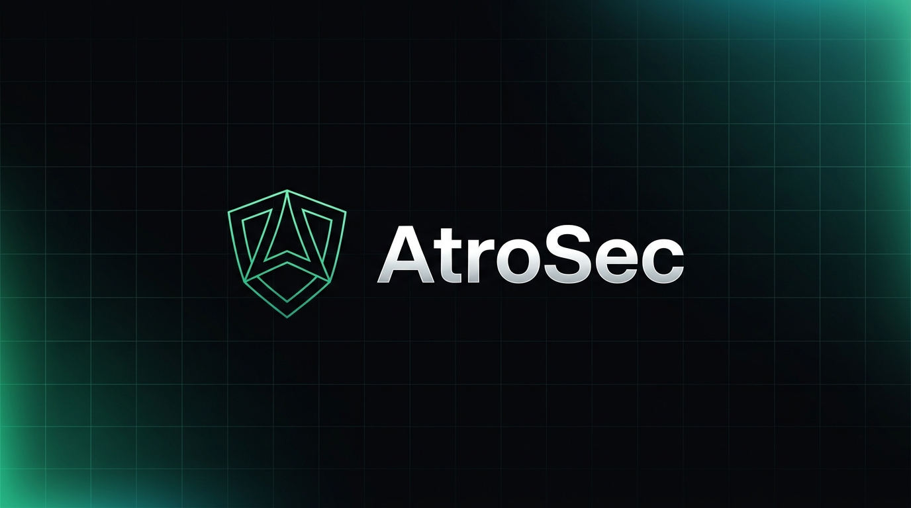

<p align="center">
  
</p>

<p align="center">
  <strong>Autonomous AST Security Auditor & Defensive Remediation Engine</strong>
</p>

<p align="center">
  
  
  
  
</p>

---

## 🛡️ О проекте

**AtroSec** — интеллектуальный сервис статического анализа безопасности кода и автоматической генерации защитных патчей.

* **🔍 Анализ уязвимостей:** поиск дефектов OWASP Top-10 (SQL-инъекции, RCE, утечки секретов, небезопасная десериализация).
* **📋 Structured Outputs:** строгий валидированный JSON-ответ через Pydantic (CWE ID, уровень критичности CVSS, номера строк).
* **⚡ Defensive Remediation:** автоматическая генерация безопасных исправлений и защитных патчей кода.

---

## 🚀 Быстрый запуск

```bash
# 1. Создать и активировать виртуальное окружение
python -m venv .venv
source .venv/bin/activate  # Для Windows: .venv\Scripts\activate

# 2. Установить зависимости
pip install -r requirements.txt

# 3. Скопировать шаблон переменных окружения
cp .env.example .env
```
